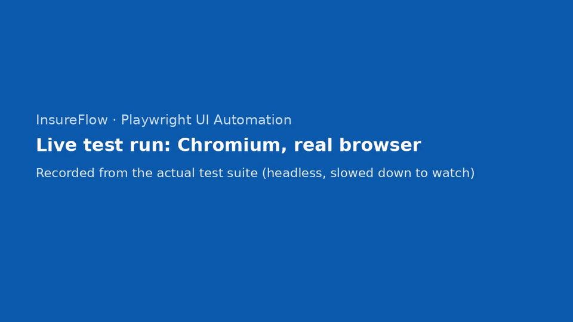

# InsureFlow – Playwright UI Automation Framework

[](https://github.com/Sadia-Sultana-Bristy/insureflow-playwright-automation/actions/workflows/playwright.yml)


This is a UI test automation framework for **InsureFlow**, an insurance customer self-service portal. It's built with **Playwright Test** and **JavaScript**. It uses the Page Object Model, custom fixtures, reusable components and data-driven tests, and it runs in CI on every push.

The suite covers real business workflows, not isolated pages. A customer gets a quote, buys a policy, finds it in their portfolio and files a claim against it. The suite then checks that the account totals update.

## Test run demo



*Four real tests from this suite running in Chromium, slowed down so each step is visible: login, policy search and filters, quote validation, and the full quote → buy → claim journey.*

**Latest results:** every push runs all 25 tests on Chromium and Firefox. See the [GitHub Actions runs](https://github.com/Sadia-Sultana-Bristy/insureflow-playwright-automation/actions/workflows/playwright.yml), open any green run, and download the HTML test report from **Artifacts**.

---

## Table of contents

- [Test run demo](#test-run-demo)
- [Business scenario](#business-scenario)
- [Features tested](#features-tested)
- [Tech stack](#tech-stack)
- [Project structure](#project-structure)
- [Installation](#installation)
- [Running tests](#running-tests)
- [Reports and evidence](#reports-and-evidence)
- [CI/CD](#cicd)
- [Framework design](#framework-design)
- [Test coverage matrix](#test-coverage-matrix)
- [Conventions](#conventions)

---

## Business scenario

InsureFlow sells **Auto, Home, Travel and Health** insurance. Signed-in customers can:

1. See a dashboard of their active policies, open claims and total annual premium
2. Search, filter and sort their policy portfolio
3. Get an instant quote in a 3-step wizard, then buy a policy online
4. File a claim against an active policy, with business-rule validation
5. Track claim status in their claim history

The application under test is in `demo-app/`. It's a zero-dependency static app, so the suite is **deterministic, self-contained and runs anywhere**, with no third-party demo site to go down or change its selectors. To run the same suite against another deployed environment, set `BASE_URL`.

### Business rules covered

| Rule | Where it's tested |
|---|---|
| Premium = coverage × product rate × tier multiplier, minimum **$99** | `quote-premium.spec.js` (data-driven) |
| Coverage must be between **$1,000** and **$2,000,000** | `quote-validation.spec.js` |
| Cover start date: today up to **90 days** ahead (boundary tested) | `quote-validation.spec.js` |
| Policy starting today is **Active**; a future start is **Pending** | `quote-premium.spec.js` |
| Claims only on **Active** policies; amount ≤ coverage limit; date not in the future | `claims.spec.js`, `policy-search.spec.js` |
| Locked accounts can't sign in; protected pages need a session | `login.spec.js`, `session.spec.js` |

---

## Features tested

| Area | What's covered |
|---|---|
| **Authentication** | Valid login, invalid password, locked account, required fields, email format, deep-link redirect after login, sign out and session protection |
| **Navigation** | Header navigation to every section, active-link state, quick actions, calls to action |
| **Dashboard** | KPI cards checked against portfolio data (counts and currency totals), empty state for new customers |
| **Search, filter and sort** | Free-text search, combined product + status filters, numeric sort validation, empty results, clearing filters |
| **Data validation** | Table rows and detail pages compared field by field with test data, currency formatting, generated ID formats |
| **Forms** | Multi-step quote wizard, claim form, required/format/range/boundary validation, character counter, form reset |
| **Error handling** | Not-found policy, locked account, invalid credentials, no active policies, terms not accepted |
| **End-to-end** | Quote → buy → policy listed → claim filed → dashboard KPIs updated |

---

## Tech stack

| Tool | Purpose |
|---|---|
| [Playwright Test](https://playwright.dev) | Test runner, browser automation, assertions, tracing |
| JavaScript (CommonJS, Node.js ≥ 20) | Test and framework code |
| Page Object Model + components | Maintainable UI abstraction |
| Playwright fixtures | Dependency injection of page objects, data and helpers |
| dotenv | Environment configuration |
| HTML + JUnit reporters | Human-readable and CI-readable results |
| GitHub Actions | CI/CD: push, PR, nightly and manual runs, cross-browser matrix |

---

## Project structure

```
insureflow-playwright-automation/
├── .github/workflows/
│   └── playwright.yml        # CI pipeline: matrix (chromium, firefox), artifacts, nightly run
├── demo-app/                 # Application under test (insurance portal, zero dependencies)
├── docs/PROJECT_PLAN.md      # Business scenario, scope, test strategy
│   ├── server.js
│   └── public/
├── tests/                    # Specs grouped by business feature
│   ├── setup/auth.setup.js   # Logs in once and saves the session (storageState)
│   ├── auth/                 # Login, validation, redirect, sign out
│   ├── dashboard/            # KPIs, navigation, new-customer empty state
│   ├── policies/             # Search, filter, sort, details, not-found
│   ├── quote/                # Data-driven pricing, wizard validation
│   ├── claims/               # Claim validation and submission
│   └── e2e/                  # Cross-module business workflow
├── pages/                    # Page Object Model
│   ├── BasePage.js
│   ├── LoginPage.js, DashboardPage.js, PoliciesPage.js,
│   ├── PolicyDetailsPage.js, QuotePage.js, ClaimsPage.js
│   └── components/           # Reusable UI components: Header, DataTable, Form
├── fixtures/
│   └── test-fixtures.js      # Custom `test` with page objects, data and loginAs()
├── utils/                    # Env config, dates, currency, pricing oracle, data factory, evidence
├── test-data/                # JSON test data: users, portfolio, quote scenarios, messages, claims
├── screenshots/              # Evidence screenshots captured at business checkpoints
├── reports/                  # Generated HTML and JUnit reports
├── playwright.config.js
├── package.json
└── README.md
```

### Folder purpose

| Folder | Purpose |
|---|---|
| `tests/` | Specs only: business intent and assertions. Grouped by feature so ownership and selective runs are easy. No raw selectors here. |
| `pages/` | One class per page. Each one exposes **locators** and **intent-revealing actions** (`buyPolicy()`, `filterBy()`), but no assertions, so the same page object serves positive and negative tests. |
| `pages/components/` | UI parts that appear on several pages (header, data tables, form error messages), written once and composed into pages. |
| `fixtures/` | Extends Playwright's `test` to inject page objects, test data and helpers like `loginAs()`. Specs never call `new`. |
| `utils/` | Framework helpers with no Playwright page dependency: env config, date and currency helpers, a **pricing oracle**, a test-data factory and screenshot evidence. |
| `test-data/` | Static, version-controlled test data and expected messages. Adding a quote scenario to the JSON adds a test without changing any code. |
| `screenshots/` | Named full-page screenshots captured at key checkpoints (for example, policy issued). They're also attached to the HTML report. |
| `reports/` | HTML report (`reports/html-report`) and JUnit XML (`reports/junit`) for CI dashboards. Contents are git-ignored. |
| `.github/workflows/` | CI pipeline definition. |
| `demo-app/` | The system under test, started automatically by Playwright's `webServer` setting. |

---

## Installation

**Prerequisites:** Node.js 20 or newer, and Git.

```bash
git clone https://github.com/Sadia-Sultana-Bristy/insureflow-playwright-automation.git
cd insureflow-playwright-automation
npm ci
npx playwright install --with-deps chromium firefox
```

Optional: copy `.env.example` to `.env` to change the port, target URL or test user.

---

## Running tests

You don't need to start the app yourself. Playwright starts `demo-app` before the tests run.

| Command | What it runs |
|---|---|
| `npm test` | Full suite on all browsers |
| `npm run test:chromium` | Full suite on Chromium only |
| `npm run test:smoke` | `@smoke`: fast critical-path checks |
| `npm run test:regression` | `@regression`: full functional regression |
| `npm run test:negative` | `@negative` and `@validation` scenarios |
| `npm run test:e2e` | `@e2e`: business workflows |
| `npm run test:headed` | Chromium with the browser visible |
| `npm run test:ui` | Playwright UI mode (watch, time-travel debugging) |
| `npm run test:debug` | Playwright Inspector |
| `npm run report` | Open the last HTML report |
| `npm run start:app` | Start the demo app manually at http://localhost:3000 |

Run a single file or a single test:

```bash
npx playwright test tests/quote/quote-premium.spec.js --project=chromium
npx playwright test -g "locked account"
```

Run against another environment:

```bash
BASE_URL=https://staging.insureflow.example npx playwright test --project=chromium
```

---

## Reports and evidence

| Artifact | Location | Notes |
|---|---|---|
| HTML report | `reports/html-report/index.html` | Steps, tags, attachments, and traces on failure |
| JUnit XML | `reports/junit/results.xml` | For CI dashboards and test management tools |
| Traces, videos, failure screenshots | `test-results/` | Kept only for failing tests |
| Evidence screenshots | `screenshots/` | Captured by `captureEvidence()` at business checkpoints |

To open a failure trace:

```bash
npx playwright show-trace test-results/<test-folder>/trace.zip
```

---

## CI/CD

`.github/workflows/playwright.yml` runs:

- **On every push and pull request to `main`**: the full suite
- **Nightly at 02:00 UTC**: a scheduled regression run
- **Manually** (Actions → *Playwright Tests* → *Run workflow*): with an optional tag filter such as `@smoke`

Pipeline details:

- A **browser matrix** (`chromium`, `firefox`) runs in parallel with `fail-fast: false`
- npm dependency caching, plus `npm ci` for reproducible installs
- `retries: 2` and `forbidOnly` in CI; traces and videos are kept on failure
- **Artifacts**: HTML report and JUnit per browser on every run; traces, videos and screenshots when a test fails
- The `github` reporter shows failures as annotations directly on the PR
- `concurrency` cancels outdated runs on the same branch

---

## Framework design

**1. Authenticate once, reuse the session.** The `setup` project logs in through the UI and saves the storage state to `.auth/customer.json`. Browser projects depend on `setup`, so feature tests start already signed in. Tests that need to start signed out use `test.use({ storageState: GUEST_STATE })`.

**2. Fixtures instead of boilerplate.** `fixtures/test-fixtures.js` extends Playwright's `test`:

```js
test('search by policy number', async ({ policiesPage }) => {
  await policiesPage.goto();
  await policiesPage.search('IF-HLT-400118');
  await expect(policiesPage.table.rows).toHaveCount(1);
});
```

**3. Page objects with components.** `BasePage` gives every page the shared `HeaderComponent`. `DataTableComponent` serves both the policies table and the claims table, and `FormComponent` reads validation messages the same way on every form.

**4. Locator strategy.** In order of preference: user-facing locators (`getByRole`, `getByLabel`), then `data-testid` for data cells and dynamic content. The suite has no XPath or CSS chains tied to page layout, and no fixed waits. It relies on Playwright's auto-waiting and web-first assertions. (The login flow deliberately includes simulated latency to prove this.)

**5. Test oracle instead of magic numbers.** `utils/premiumCalculator.js` implements the pricing rules independently. Quote tests check that the UI premium matches **both** the oracle and the documented expected value, which also catches out-of-date test data.

**6. Data-driven tests.** Each premium scenario in `test-data/quotes.json` generates its own test. Invalid inputs (coverage values, claim amounts, email formats) are looped inside `test.step` so failures are reported clearly.

**7. Test isolation.** Every test gets a fresh browser context with seeded data, and generated data (`utils/dataFactory.js`) uses unique values. Tests run fully in parallel, in any order. The suite was checked with `--repeat-each=4 --workers=4`: 100 runs, 0 flakes.

**8. Readable reporting.** Tags (`@smoke`, `@regression`, `@negative`, `@validation`, `@e2e`) use Playwright's native `tag` option, and long flows are split into `test.step` blocks. Annotations (the policy and claim IDs) appear in the HTML report.

---

## Test coverage matrix

| Spec | Tests | Smoke | Regression | Negative / validation | E2E |
|---|:-:|:-:|:-:|:-:|:-:|
| `auth/login.spec.js` | 5 | ✔ | ✔ | ✔ | |
| `auth/session.spec.js` | 1 | ✔ | ✔ | | |
| `dashboard/dashboard.spec.js` | 3 | ✔ | ✔ | | |
| `policies/policy-search.spec.js` | 7 | ✔ | ✔ | ✔ | |
| `quote/quote-premium.spec.js` | 3 (data-driven) | | ✔ | | |
| `quote/quote-validation.spec.js` | 3 | | ✔ | ✔ | |
| `claims/claims.spec.js` | 2 | ✔ | ✔ | ✔ | |
| `e2e/policy-lifecycle.spec.js` | 1 | ✔ | ✔ | | ✔ |
| **Total** | **25** | **6** | **25** | **10** | **1** |

### Test accounts

| Persona | Email | Password | Used for |
|---|---|---|---|
| Existing customer | `alex.morgan@insureflow.test` | `Secure@123` | Default session, with a mixed portfolio |
| New customer | `priya.shah@insureflow.test` | `Secure@123` | Empty states |
| Locked account | `locked.user@insureflow.test` | `Secure@123` | Negative authentication |

---

## Conventions

- Test titles describe **behaviour** ("locked account cannot sign in"), not implementation details.
- Assertions belong in specs; page objects only locate elements and act on them.
- Expected UI text lives in `test-data/messages.json`, so a copy change means one edit.
- New pages: add a page object in `pages/`, register it in `fixtures/test-fixtures.js`, then write specs in `tests/<feature>/`.

## Possible extensions

- API-level setup (seed policies through an API instead of the UI) to speed up the E2E preconditions
- Visual regression with `toHaveScreenshot()` for key screens
- Accessibility checks with `@axe-core/playwright`
- Publishing the HTML report to GitHub Pages

---

**Author:** Sadia Sultana Bristy, QA Engineer · [Portfolio](https://sadia-sultana-bristy.github.io) · [LinkedIn](https://www.linkedin.com/in/sadia-sultana-bristy) · [GitHub](https://github.com/Sadia-Sultana-Bristy)
